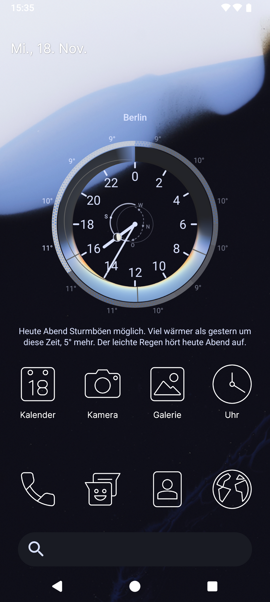

# LightTimeClouds

[English](README.md) | **Deutsch**

Android-Homescreen-Widget: eine analoge Sonnen- und Monduhr, inspiriert von [sunclock.net](https://sunclock.net) und von der Wetteruhr [OpenSky](https://donohoe.dev/weather/).



## Features

- **Himmelsring:** der Himmel jeder Stunde des Tages um ein normales 12-Stunden-Zifferblatt (24 Stunden wählbar), vom Tag über Abendrot und blaue Stunde bis zur Nacht, physikalisch berechnet, wie das Auge ihn sieht
- **Sonne und Mond** im Ring in ihrer echten Höhe, mit ihren Bahnen über den Tag, der Mond mit seiner Phase
- **Wetter** (optional): Bewölkung, Regen und Schnee der nächsten Stunden als Ring, Temperaturen am Rand und das Wetter in wenigen Worten neben der Uhr
- **Markierungen** für Sonnenaufgang, Sonnenuntergang, Sonnenmittag und den nächsten Wecker
- **Orte** mit eigener Zeitzone, eingetippt oder aus einer Karten-App geteilt; mehrere Widgets ergeben eine Weltuhr
- **Privat:** keine Standort-Berechtigung, kein Tracking; das Netz dient nur der Wettervorhersage von Open-Meteo
- Hell- und Dunkelmodus in Material-You-Farben, frei skalierbar, auf Deutsch, Englisch, Spanisch und Französisch

## Installation

[](https://apps.obtainium.imranr.dev/redirect?r=obtainium://add/https://github.com/aqja/lighttimeclouds)

An jedem [GitHub-Release](https://github.com/aqja/lighttimeclouds/releases) hängt die APK, von dort installiert und aktualisiert sie [Obtainium](https://github.com/ImranR98/Obtainium). Bisher gibt es nur Betas: In Obtainium „Include prereleases“ einschalten. F-Droid soll folgen.

Versionen sind Daten: 0.11.18-1 ist der erste Release vom 18. November 2026; die erste Zahl zählt die Jahre seit 2026.

## Projektstruktur

```
core/   – reine Kotlin/JVM-Logik ohne Android-Abhängigkeit: Sonnen-/Mondberechnung, Zifferblatt-Zeitmapping, Wettervorhersage, Himmelsfarben (inkl. Unit-Tests)
app/    – Android-Modul: Widget, Konfigurations-App (Jetpack Compose), Persistenz, Rendering
```

## Bauen & Testen

Voraussetzungen:

- **JDK 17–27** (z. B. Arch: `jdk-openjdk`). Gradle selbst lädt der Wrapper (`./gradlew`) herunter.
- **Android SDK** mit `platforms;android-<compileSdk>` und `build-tools` (Versionen siehe `app/build.gradle.kts` bzw. AGP-Default). Android Studio ist nicht nötig; die Command-line-Tools genügen, z. B.:

  ```sh
  android --sdk=$HOME/Android/Sdk sdk install platforms/android-37.0 build-tools/36.0.0
  echo "sdk.dir=$HOME/Android/Sdk" > local.properties
  ```

  Ohne `local.properties` nimmt Gradle `ANDROID_HOME`; manche Paketierungen setzen das systemweit auf einen anderen Pfad.

```sh
./gradlew :core:test        # Unit-Tests der Astronomie-, Zeit-, Wetter- und Himmelslogik
./gradlew :app:testDebugUnitTest  # Renderer-Tests; rendert Vorschaubilder nach app/build/previews/<Gruppe>/ (Robolectric)
./gradlew assembleDebug     # APK unter app/build/outputs/apk/debug/
./gradlew installDebug      # direkt auf ein per adb verbundenes Gerät
```

Die Himmelsfarben werden beim Build aus `core/.../sky/SkyModel.kt` als Tabelle vorberechnet (Gradle-Task `:core:generateSkyTable`); im Repo liegt keine Binärdatei.

Zwei Python-Skripte unter `tools/` (Ausführung mit [uv](https://docs.astral.sh/uv/), Abhängigkeiten stehen im Skript) gehören zur Astronomie; der App-Build braucht sie nicht:

```sh
uv run tools/astro_series.py        # kürzt ELP 2000-82B und VSOP87 neu nach core/.../astro/AstroSeries.kt
uv run tools/reference_ephemeris.py # Referenzwerte aus JPL DE440s für die Tests (core/src/test/resources/astro/)
```

Beide laden ihre Rohdaten (IMCCE-Reihen, ~32 MB Ephemeride) in `~/.cache/lighttimeclouds/`, nicht ins Repo.

Zum manuellen Testen: Widget auf den Homescreen ziehen, über das Launcher-Icon „LightTimeClouds“ konfigurieren; Logs per `adb logcat`.

### Übersetzungen

Alle UI-Texte liegen in `app/src/main/res/values/strings.xml` (Englisch, zugleich Fallback für alle anderen Sprachen) und `values-de/strings.xml` (Deutsch). Für eine weitere Sprache `values-de/strings.xml` nach `values-<Sprachcode>/` kopieren und übersetzen; `./gradlew :app:lintDebug` meldet fehlende Einträge (`MissingTranslation`). Datum, Uhrzeit und Zahlen formatiert die App selbst passend zur Sprache. Ab Android 13 lässt sich die App-Sprache in den Systemeinstellungen getrennt vom Gerät wählen.

## Credits

Die Sonnen- und Mondberechnung (`core/.../astro/`) beruht direkt auf den Primärquellen: der Mond auf der Mondtheorie ELP 2000-82B (M. Chapront-Touzé, J. Chapront, A&A 124, 50, 1983 und A&A 190, 342, 1988), die Sonne auf der Planetentheorie VSOP87 (P. Bretagnon, G. Francou, A&A 202, 309, 1988), beide in der Fassung des [IMCCE](https://www.imcce.fr/) (Observatoire de Paris) und für die App gekürzt (zwischen 2000 und 2050 höchstens 4″ Fehler beim Mond, 2″ bei der Sonne); Nutation, Schiefe der Ekliptik und Sternzeit folgen den IERS Conventions 2010 (IERS Technical Note 36), die Refraktion Sæmundsson (1986). Geprüft wird gegen die JPL-Ephemeride DE440s. Angeregt wurden Umfang und Auswahl der Sonnenereignisse von [SunCalc](https://github.com/mourner/suncalc) von Volodymyr Agafonkin, das frühere Versionen der App portiert hatten.

Die Himmelsfarben des Rings berechnet `core/.../sky/SkyModel.kt`, eine Portierung von [Horizon](https://github.com/dnlzro/horizon) von Daniel Lazaro (MIT-Lizenz), das auf [„Production Sky Rendering“](https://www.shadertoy.com/view/slSXRW) von Andrew Helmer (MIT laut Autor) und dem Artikel von Sébastien Hillaire (2020) beruht, erweitert um Mehrfachstreuung nach Hillaire (2020), eine spektrale Rechnung mit Sonnenspektrum und Ozon-Absorptionsquerschnitten aus [Precomputed Atmospheric Scattering](https://github.com/ebruneton/precomputed_atmospheric_scattering) von Eric Bruneton (BSD-3-Clause), Aerosole aus der Mie-Theorie (Bohren und Huffman) mit einer von AERONET gemessenen Größenverteilung (Dubovik et al. 2002) und ein Modell des menschlichen Sehens (Helligkeit nach Tumblin, Hodgins und Guenter 1999, der Farbbeitrag der Stäbchen nach Cao et al. 2008 und Wanat und Mantiuk 2014); Lizenztexte in [`THIRD_PARTY_NOTICES.md`](THIRD_PARTY_NOTICES.md).

Die Wetterdaten stammen von [Open-Meteo.com](https://open-meteo.com/) (Lizenz CC BY 4.0).

Alle Formeln, Konstanten und Vereinfachungen der Astronomie, des Himmelsmodells und der Wetterauswertung, mit Quellen, beschreibt [`docs/PHYSIK.md`](docs/PHYSIK.md) (englisch: [`docs/PHYSICS.md`](docs/PHYSICS.md)); wie aus dem Licht des Himmels die Farben werden, die das Auge sieht, [`docs/PHYSIOLOGIE.md`](docs/PHYSIOLOGIE.md) (englisch: [`docs/PHYSIOLOGY.md`](docs/PHYSIOLOGY.md)).

## Lizenz

LightTimeClouds steht unter der [MIT-Lizenz](LICENSE.md). Portierte oder übernommene Teile fremder Projekte (Horizon, Precomputed Atmospheric Scattering) behalten ihre eigenen Lizenzen, siehe [`THIRD_PARTY_NOTICES.md`](THIRD_PARTY_NOTICES.md).
