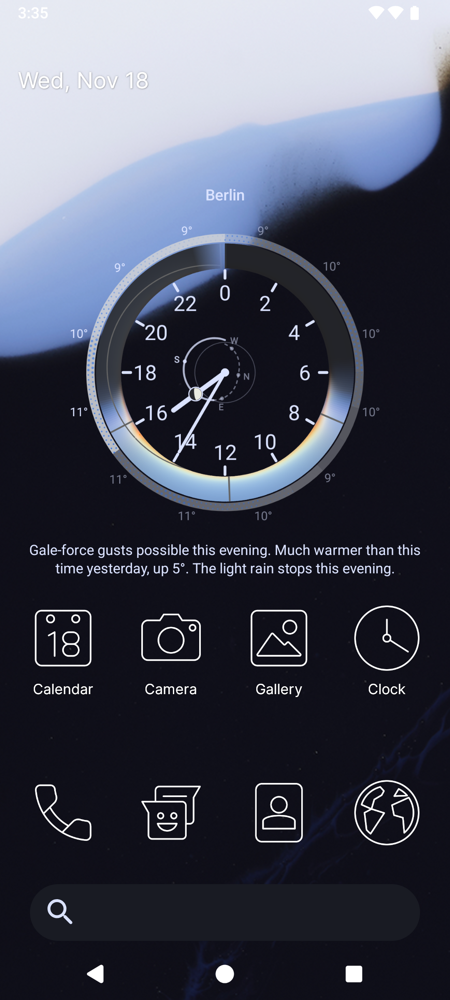

# LightTimeClouds

**English** | [Deutsch](LIESMICH.md)

Android home screen widget: an analog sun and moon clock, inspired by [sunclock.net](https://sunclock.net) and by the weather clock [OpenSky](https://donohoe.dev/weather/).



## Features

- **Sky ring:** the sky of every hour of the day around a 24-hour clock face (12 hours optional), from daylight through sunset and blue hour to night, computed physically as the eye sees it
- **Sun and moon** in the ring at their real height, with their paths over the day, the moon with its phase
- **Weather** (optional): cloud cover, rain and snow of the coming hours as a ring, temperatures around the edge and the weather in a few words beside the clock
- **Marks** for sunrise, sunset, solar noon and the next alarm
- **Places** with their own time zone, typed in or shared from a map app; several widgets make a world clock
- **Private:** no location permission, no tracking; the network is only used for the weather forecast from Open-Meteo
- Light and dark mode in Material You colors, freely resizable, in English, German, Spanish and French

## Installation

[](https://apps.obtainium.imranr.dev/redirect?r=obtainium://add/https://github.com/aqja/lighttimeclouds)

The APK is attached to every [GitHub release](https://github.com/aqja/lighttimeclouds/releases), from where [Obtainium](https://github.com/ImranR98/Obtainium) installs and updates it. For now there are only betas: turn on "Include prereleases" in Obtainium. F-Droid is to follow.

Versions are dates: 0.11.18-1 is the first release on 18 November 2026; the first number counts the years since 2026.

## Project structure

```
core/   – plain Kotlin/JVM logic without Android dependencies: sun and moon calculation, mapping of time to the clock face, weather forecast, sky colors (with unit tests)
app/    – Android module: widget, settings app (Jetpack Compose), persistence, rendering
```

## Building and testing

Requirements:

- **JDK 17–27** (e.g. Arch: `jdk-openjdk`). The wrapper (`./gradlew`) downloads Gradle itself.
- **Android SDK** with `platforms;android-<compileSdk>` and `build-tools` (versions in `app/build.gradle.kts` or the AGP default). Android Studio is not needed; the command-line tools are enough, e.g.:

  ```sh
  android --sdk=$HOME/Android/Sdk sdk install platforms/android-37.0 build-tools/36.0.0
  echo "sdk.dir=$HOME/Android/Sdk" > local.properties
  ```

  Without `local.properties`, Gradle uses `ANDROID_HOME`; some packagings set it system-wide to a different path.

```sh
./gradlew :core:test        # unit tests of the astronomy, time, weather and sky logic
./gradlew :app:testDebugUnitTest  # renderer tests; renders preview images to app/build/previews/<group>/ (Robolectric)
./gradlew assembleDebug     # APK in app/build/outputs/apk/debug/
./gradlew installDebug      # straight to a device connected via adb
```

The sky colors are precomputed as a table from `core/.../sky/SkyModel.kt` during the build (Gradle task `:core:generateSkyTable`); the repository contains no binary file for it.

Two Python scripts in `tools/` (run with [uv](https://docs.astral.sh/uv/); dependencies are declared in the script) belong to the astronomy; the app build does not need them:

```sh
uv run tools/astro_series.py        # re-truncates ELP 2000-82B and VSOP87 into core/.../astro/AstroSeries.kt
uv run tools/reference_ephemeris.py # reference values from JPL DE440s for the tests (core/src/test/resources/astro/)
```

Both download their raw data (IMCCE series, ~32 MB ephemeris) to `~/.cache/lighttimeclouds/`, not into the repository.

For manual testing: drag the widget onto the home screen and configure it via the "LightTimeClouds" launcher icon; logs via `adb logcat`.

### Translations

All UI texts are in `app/src/main/res/values/strings.xml` (English, also the fallback for all other languages), the translations in `values-de/`, `values-es/` and `values-fr/`. For another language, copy one of the translations, e.g. `values-de/strings.xml`, to `values-<language code>/` and translate it; `./gradlew :app:lintDebug` reports missing entries (`MissingTranslation`). The app formats dates, times and numbers itself to suit the language. From Android 13 on, the app language can be chosen in the system settings independently of the device language.

## Credits

The sun and moon calculation (`core/.../astro/`) is based directly on the primary sources: the moon on the lunar theory ELP 2000-82B (M. Chapront-Touzé, J. Chapront, A&A 124, 50, 1983 and A&A 190, 342, 1988), the sun on the planetary theory VSOP87 (P. Bretagnon, G. Francou, A&A 202, 309, 1988), both as distributed by the [IMCCE](https://www.imcce.fr/) (Paris Observatory) and truncated for the app (between 2000 and 2050 at most 4″ error for the moon, 2″ for the sun); nutation, obliquity of the ecliptic and sidereal time follow the IERS Conventions 2010 (IERS Technical Note 36), refraction follows Sæmundsson (1986). The results are checked against the JPL ephemeris DE440s. The scope and selection of sun events were inspired by [SunCalc](https://github.com/mourner/suncalc) by Volodymyr Agafonkin, which earlier versions of the app had ported.

The sky colors of the ring are computed by `core/.../sky/SkyModel.kt`, a port of [Horizon](https://github.com/dnlzro/horizon) by Daniel Lazaro (MIT License), which is based on ["Production Sky Rendering"](https://www.shadertoy.com/view/slSXRW) by Andrew Helmer (MIT according to its author) and on the paper by Sébastien Hillaire (2020), extended with multiple scattering after Hillaire (2020), a spectral calculation with the solar spectrum and ozone absorption cross-sections from [Precomputed Atmospheric Scattering](https://github.com/ebruneton/precomputed_atmospheric_scattering) by Eric Bruneton (BSD-3-Clause), aerosols from Mie theory (Bohren and Huffman) with a size distribution measured by AERONET (Dubovik et al. 2002), and a model of human vision (brightness after Tumblin, Hodgins and Guenter 1999, the rods' color contribution after Cao et al. 2008 and Wanat and Mantiuk 2014); license texts in [`THIRD_PARTY_NOTICES.md`](THIRD_PARTY_NOTICES.md).

Weather data from [Open-Meteo.com](https://open-meteo.com/) (CC BY 4.0 license).

All formulas, constants and simplifications of the astronomy, the sky model and the weather evaluation, with sources, are described in [`docs/PHYSICS.md`](docs/PHYSICS.md) (German: [`docs/PHYSIK.md`](docs/PHYSIK.md)); how the sky's light is turned into the colors the eye sees, in [`docs/PHYSIOLOGY.md`](docs/PHYSIOLOGY.md) (German: [`docs/PHYSIOLOGIE.md`](docs/PHYSIOLOGIE.md)).

## License

LightTimeClouds is licensed under the [MIT License](LICENSE.md). Ported or adopted parts of other projects (Horizon, Precomputed Atmospheric Scattering) keep their own licenses, see [`THIRD_PARTY_NOTICES.md`](THIRD_PARTY_NOTICES.md).
